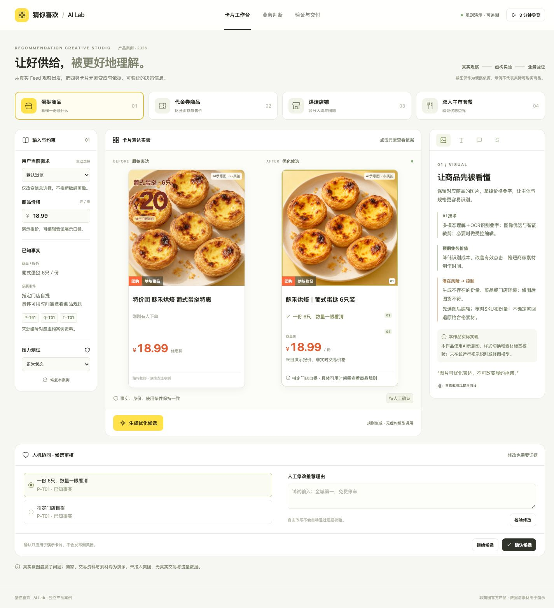
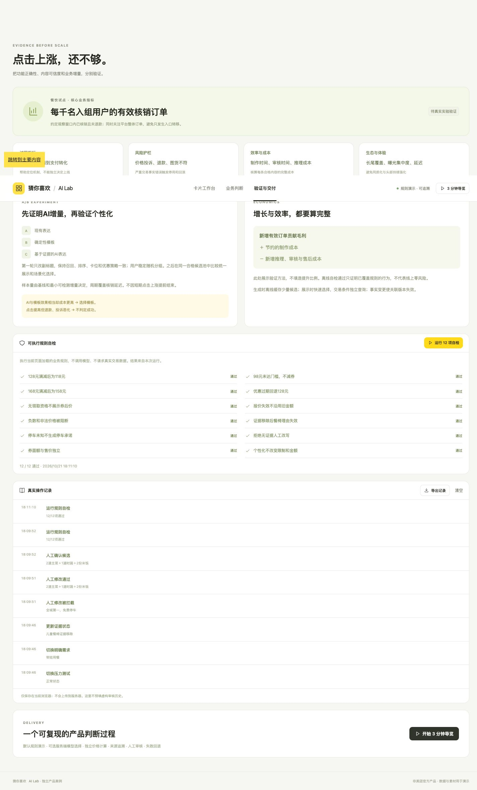

# 验证记录

日期：2026-10-21。仅记录实际执行的检查，不代表真实业务效果。

## 自动检查

- `npm run check`：JavaScript 语法检查通过。
- `npm test`：12个测试通过，覆盖价格解析、优惠边界、四案例与四场景不变量、证据失效、自由文本阻断、异常恢复、面额分离、素材标签回退、服务端输入校验以及本机HTTP集成。
- 页面中的“运行12项自检”：实际运行后12/12通过。与Node测试覆盖内容有重叠，不应相加为24个独立业务场景。
- 本机HTTP测试确认`.env`和`server.mjs`不可经静态服务读取；未配置模型时返回503，不伪造成功。

## 浏览器实测

在本地应用中通过实际点击、输入、切换执行，未使用预填成功结果。

| 操作 | 实际结果 |
| --- | --- |
| 输入商品价98元 | 显示98元，提示未达满128门槛 |
| 输入168元 | 显示券后158元 |
| 默认128元，优惠过期 | 显示商品价128元，撤下券后表达 |
| 默认128元，取消领取资格 | 显示128元和无领取资格说明 |
| 报价失效 | 显示“价格待确认”，确认按钮不可用 |
| 选择带娃用餐 | 选择“提供儿童餐椅” |
| 移除儿童餐椅证据 | 回退到套餐内容，不保留服务承诺 |
| 人工输入“全城第一，免费停车” | 拦截，显示证据不足 |
| 人工填写已有有效理由并确认 | 显示人工已确认 |
| 代金券案例 | 200元面额与174元售价分离 |
| 店铺案例 | 20元明确标为人均参考 |
| 来源按钮 | 正常打开内部来源弹窗 |
| 业务判断页 | 正常展示观察、边界、技术与流程 |
| 完整五步导览 | 正常切换案例、异常状态并到达验证页 |
| 页面规则自检 | 实际返回12/12通过 |

浏览器控制台检查未发现error或warn日志。390px手机断点检查未发现横向溢出或加载失败图片；1440px桌面布局及默认浏览器宽度也完成检查。

## 发现并修正的问题

1. 初次浏览器测试发现：输入价格后，在部分输入路径中卡片仍保留旧值。将同步改为`input`事件即时重算，保留光标，并再次验证98、128和168元。
2. 手机断点中“已知事实”标题与输入标签重叠。改为明确的样式类，移除脆弱的按标签序号选择方式。
3. 手机屏幕上输入区先占据较长空间。将卡片对比提前，输入与解释放在其后。
4. 放大价格条件、事实与风险说明字号，提高可读性。

## 限制

- 未调用真实外部语言模型，不能宣称提供方接入已验收。
- 未进行线上A/B实验，没有成交或效率提升的实测数据。
- 图片标签校验是显式模拟，没有运行真实视觉检测器。
- 未接入美团价格、商家、推荐或交易接口。
- 工作流模板位于`docs/workflows`，未作为GitHub Actions启用；没有伪造远程CI通过状态。

